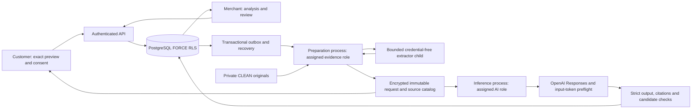

# Phase 5 AI resolution intelligence

This document supersedes the Phase 1 proposed AI contract. Implemented contracts are in packages/shared/src/ai.ts and packages/ai-core. AI produces merchant-only, nonbinding internal advice. It cannot create proposals, send customer offers, close cases, or authorize payment operations.

## Data flow and trust boundaries

The API owns trusted records and deterministic candidate construction. Preparation can read only assigned-tenant CLEAN evidence through the existing scanner/storage boundary. Inference has a different nonowner, NOBYPASSRLS database login, no grants on payments/authentication/original evidence tables, no PayPal credentials and no object-storage credentials. Worker launcher passes explicit environment allowlists; inference refuses forbidden credential names at startup. Child extractors receive only OS runtime variables, a MIME label and bytes on stdin, with memory, wall-clock and output caps. This is process separation, not an OS/container security sandbox: production needs separate identities, filesystem/network policies and secret mounts.

## Provider and verified documentation

Pinned model: gpt-5.4-mini-2026-03-17. Lightweight fetch adapter; fixed api.openai.com host, no redirects, no tools, store:false, reasoning effort none, strict JSON Schema generated from Zod. Response bodies stream under 1 MiB, calls time out after 45 seconds, correlation IDs are allowlisted. Model, prompt and schema are immutable per run. OPENAI_MODEL is retained only as an informational legacy environment value; unsupported runtime model overrides are not accepted.

Official documentation reviewed 2026-11-10:

- [Model capabilities and pricing](https://developers.openai.com/api/docs/models/gpt-5.4-mini): text/image input, Responses and structured output. Standard rates used for conservative estimates: input USD 0.75/M tokens, output USD 4.50/M tokens; no cached-token discount assumed.
- [Structured output](https://developers.openai.com/api/docs/guides/structured-outputs): strict schema is structural protection, not factual correctness.
- [Input token counting](https://developers.openai.com/api/reference/resources/responses/subresources/input_tokens/methods/count): POST /v1/responses/input_tokens.
- [Data controls](https://developers.openai.com/api/docs/guides/your-data): store:false is not zero retention; standard abuse-monitoring retention can normally be up to 30 days.

These are documentation checks, not account-level model or endpoint verification. No API key was available during implementation. The dedicated smoke acceptance gate must verify the chosen model/request schema on the actual account.

Preflight is itself an external transmission and requires the same consent as generation. Limit 16000 input tokens and 4000 output tokens. For unavailable preflight (404/405/501), text-only requests use UTF-8 byte length of the entire serialized envelope plus 2048 as a deliberately conservative estimate. Oversize requests fail closed; images require working provider preflight and never use an invented image-token estimate. Other preflight errors fail/retry within bounded durable attempts. No request proceeds on an invalid token count.

Each attempt reserves 30000 micro-USD (USD 0.03), covering configured maxima at the pinned price. At most three attempts, one active inference per tenant, five new runs/tenant/minute, immutable sharing-policy daily budget USD 0.01–5 (default 5), and USD 0.50 logical-operation ceiling. Unknown generation outcomes retain their full reservation; retries reserve again. Billing estimates are not provider invoices. Rate/price changes require a reviewed configuration/schema revision.

## Context, extraction and consent

Only explicit allowlisted verified order/capture fields, complaint fields, customer-visible comments, non-AI public timeline events and purchase-policy clauses enter context. No private merchant notes, full provider transaction identifiers, signed URLs, storage keys or unrelated identities are transmitted. Internal source references remain local; providers receive case-local aliases. Email/URL/long identifier redaction is heuristic and cannot guarantee anonymization. Image previews may visibly contain personal data.

Customer explicitly selects evidence. Only CLEAN, AVAILABLE, scanned evidence with matching content hash may be read. UTF-8 is decoded strictly; PNG/JPEG are re-encoded with metadata removed and resized to at most 1024×1024 (20M input pixels, 2 MiB output). PDFjs parses locally up to 20 pages/100000 characters; pages without text render to at most four bounded images. No remote PDF/image URLs, external OCR service or original PDF is sent. Unsupported/password-protected/malformed extraction creates an omission and forces information/human review. Extraction failures are recorded in context omissions; successful extraction metadata/text are versioned separately. Original evidence remains unchanged.

Context preparation is local and asynchronous. READY contexts contain encrypted exact provider request, encrypted source catalog, source manifest, sharing policy/version, model/prompt/schema/extractor versions, and a SHA-256 consent hash over manifest, policy and exact request. Customer sees all transmitted text, system instructions, schema/settings and image derivatives before acknowledging the provider-retention disclosure. Base64 is represented visually by the exact image in the UI. Consent is immutable and per-case; the merchant cannot consent for the customer.

Revocation appends a record. Consent is checked before preflight, before generation and before accepting results. An authorization recorded immediately before dispatch is the transmission boundary: a request already authorized/in flight cannot be recalled. Revocation blocks later dispatches, review and merchant exposure of returned findings. Already-transmitted data follows provider retention; the application cannot promise provider deletion or undo transmission. Hashes, usage and audit proof remain. Local encrypted context/output expire after 30 days; the inference sweeper clears payloads while preserving immutable provenance. Encrypted extraction derivatives clear after 30 days; original Phase 4 retention is separate. Without an enabled inference sweeper, cleanup waits; monitor it operationally.

Any case version, public comment/timeline set, evidence hash/status, policy hash/version, order/capture version/status/financial counters, latest sharing policy, expiry, prompt/schema or selected manifest change invalidates the applicable snapshot. New preview and customer consent are required. Private notes and AI bookkeeping events do not enter the provider context. No stale approval exception exists.

## Deterministic policy and citations

Reuse complaintPolicy against purchase-time version and submission timestamp. Missing, synthetic, ambiguous/conflicting or invalid policies permit only information/human escalation; no invented refund entitlement. Evidence omissions or missing requirements likewise remove financial candidates. policy-engine computes candidate amounts with bigint, USD, remaining verified balance, policy amount ceilings and partial-refund basis points. Financial suggestions are only discrete server candidates, never model-calculated amounts. Available replacements and no-financial-remedy options are distinct from recommended choices.

Model outputs only a candidate ID. Server validates strict schema; every summary/finding/recommendation/contradiction citation resolves to its immutable authorized catalog, policy citations are POLICY sources, document observations cite document sources, quotes and offsets/page must match, and finding IDs are unique. Trusted facts render directly from server records, separately from model allegations/observations. Citation existence does not prove semantic entailment; human evaluation is required.

Stored output is concise, encrypted explanation, not hidden chain-of-thought. Source catalog has typed composite FKs to real case/order/capture/comment/timeline/clause/extraction records. Review decisions are append-only. Owner/approver approval or revision applies the same candidate, authorization, freshness, consent and uncertainty checks. Agents may reject but cannot approve/revise. Expected versions and idempotency keys protect concurrent actions. Internal approval has no downstream execution effect.

## Recovery and state

QUEUED → RUNNING → SUCCEEDED / NEEDS_REVIEW / FAILED / STALE. Strict invalid output/refusal, unsupported citations and uncertainty cannot become executable authority. At most three attempts; transient 429/5xx/transport use bounded backoff and Retry-After. No automatic prompt repair or tools expansion.

Transactional outbox is committed with requests. Separate preparation/inference BullMQ queues deliver at least once. Database leases fence results; partial unique indexes deduplicate active case/snapshot work and enforce one active tenant run. Outbox publish-after-ack and periodic database sweeps recover lost queue delivery and expired leases. Redis retention is not the source of truth. Unknown usage remains conservatively committed. No database transaction spans storage or provider calls.

## Evaluation and real acceptance

tests/evaluation/cases.json contains 40 synthetic case records: 20 development and 20 held-out, distinct IDs and narratives. Prompt/schema fingerprint was frozen before held-out safety execution. Default evaluation loads development only; held-out execution requires AI_EVAL_HELDOUT_ACK=FROZEN_PROMPT_NO_TUNING and an unchanged prompt fingerprint. Do not change prompts after viewing held-out output; use a new independently authored holdout for subsequent tuning.

The deterministic harness checks candidate bounds, missing/legacy/current constraints, invented candidates, uncertainty rejection and invalid output. These are safety assertions, not model accuracy or evidence of semantic resistance to prompt injection. Real-provider quality, supported-claim precision, appropriate escalation, contradiction recall, latency and token-cost distribution remain unmeasured without actual outputs. Two human reviewers must label claim support and adjudicate disagreements. Do not claim accuracy from 40 synthetic cases.

Dedicated synthetic smoke:

1. pnpm ai:smoke:preview writes an ignored exact request/manifest/disclosure under .local.
2. Review it and supply the printed consent hash, explicit opt-in and sharing acknowledgment.
3. pnpm ai:smoke runs a credential-restricted child, one budgeted provider generation, strict/citation checks and a sanitized receipt. No DB or payment credentials are passed.
4. Missing key/consent fails before transmission. Never run this automatically in CI.

Real text, image and counting compatibility, real usage, and held-out quality acceptance remain Phase 5 completion gates. See PHASE-5-REPORT.md.

## Gemini extension

The preceding OpenAI-specific provider/retention details still apply to OpenAI. The additional reviewed Gemini adapter uses its own model, wire arguments, disclosure, conservative pricing and provider-scoped consent. See [Gemini integration](GEMINI.md) for authoritative selection, unpaid-data restrictions, source provenance and deferred verification. There is no model/provider fallback. The frozen OpenAI prompt and held-out evaluation were not tuned.
