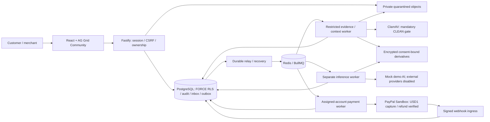
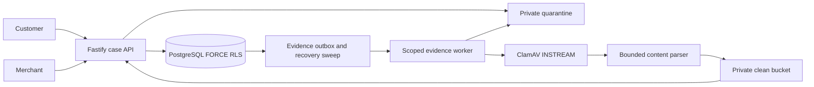

# Architecture

## Boundaries

Fastify modular monolith plus a separate worker, no independent business microservices. PostgreSQL owns state, money, audit, inbox/outbox. Redis is a disposable scheduling accelerator. API and worker share contracts/schema but not application entrypoints.



| Module        | Responsibility                                             | Dependencies                                                 |
| ------------- | ---------------------------------------------------------- | ------------------------------------------------------------ |
| web           | Presentation/actions                                       | shared DTOs, HTTP, PayPal browser approval SDK               |
| api           | Auth, authorization, transitions, durable intents          | shared, policy-engine, paypal-client adapters                |
| worker        | Evidence, AI, payment execution, reconciliation and outbox | shared, policy-engine, paypal-client, private infrastructure |
| shared        | Zod contracts, states/money                                | Zod; no Prisma, credentials or app imports                   |
| policy-engine | Pure eligibility and financial/policy constraints          | shared; explicit clock/facts                                 |
| paypal-client | Fixed-origin OAuth/REST/error mapping                      | shared; no DB/UI/case authority                              |

Routes call use cases through persistence/clock/storage/AI/payment interfaces. Prisma/BullMQ stay in adapters. Generate OpenAPI from shared Zod. API modules: auth, orders, cases, evidence, proposals, payments, audit, analytics.

## States

Case: OPEN -> INVESTIGATING -> NEGOTIATING -> RESOLUTION_PENDING -> RESOLVED. Before execution may ESCALATE or CLOSE_WITHOUT_AGREEMENT with human reason. UNKNOWN refund stays RESOLUTION_PENDING. Definitive failure allows NEGOTIATING after reservation release. Replacement needs merchant fulfillment plus customer receipt acknowledgment; unresolved delivery escalates. Evidence request returns to INVESTIGATING. Internal state never closes a provider dispute.

Proposal: DRAFT -> OFFERED -> AGREED -> EXECUTING -> FULFILLED. OFFERED may become REJECTED/EXPIRED/SUPERSEDED. Merchant approval publishes immutable content; customer acceptance makes AGREED. Counter creates new DRAFT and supersedes unexecuted offer. Executing proposals cannot be countered. Content changes always create new versions.

```mermaid
sequenceDiagram
  participant M as Merchant
  participant A as API
  participant D as PostgreSQL
  participant W as Worker
  participant P as PayPal
  M->>A: Approve immutable proposal
  A->>D: Approval and audit
  Note over A,D: Customer separately accepts same version
  M->>A: Execute agreed proposal
  A->>D: Lock; validate; reserve; operation + outbox
  D-->>A: Commit
  A-->>M: 202 operation ID
  W->>D: Claim operation lease
  W->>P: Refund stable key/body
  P-->>W: Result or timeout
  W->>D: Completion or UNKNOWN
  Note over W,P: Reconcile outside DB transactions
```

## Deployment and recovery

Outbox relay claims short leases with SKIP LOCKED; enqueue deterministic job IDs and mark delivered after acknowledgment. Crash can duplicate delivery; handlers inspect durable state. Independently sweep nonterminal operations and undelivered events even after Redis loss. Inbox persists original untrusted deliveries before acknowledgment; verification precedes domain effects. Queue payloads carry IDs/schema versions, not evidence or secrets.

Render web/API/worker plus managed PostgreSQL/Redis/private S3. Same-origin reverse proxy for cookies/CSRF; public HTTPS webhook. Separate local/CI/Sandbox/future-live resources. One worker codebase, logical queues and bounded concurrency; before live funds separate AI/evidence and payment process roles with scoped credentials. Demo may run one process, but model receives no tools/credentials. Scan in a network-disabled resource-limited subprocess.

Redacted correlated logs and metrics: outbox age, queue lag, UNKNOWN age, reconciliation drift, blocked executions, citation/model failure. Alert on balance mismatch and UNKNOWN >5 minutes (target). Readiness checks DB/Redis, never external providers; drain leases on shutdown. Expand/contract migrations; restore drills include operations/outbox.

PostgreSQL clause retrieval avoids vector infrastructure. USD/one capture constrain demo. RLS needs transaction-local pooled context. External dashboard refunds, provider access, model quality and policy interpretation remain risks. Validate current hosting/network/backup capabilities before provisioning.

## Phase 2 implementation decisions

Local S3 uses digest-pinned SeaweedFS 4.12 after planned MinIO registries denied image pulls. The S3 boundary is unchanged; no admin console is exposed. Runtime persistence uses Prisma scalar models and explicit scoped queries; SQL migrations own foreign keys, RLS and guards. API/worker do not import each other's entrypoints. The worker has only foundation.ping; there is no outbox relay or financial executor yet. Image digests target Linux amd64. These local images/settings are development infrastructure.

## Phase 3: shared payment application core

`packages/payment-store` contains the shared payment use cases, PostgreSQL adapter, engine, receipt encryption and durable delivery logic. It is an in-process package, not another service. API and worker use it without importing each other's applications; existing Prisma/schema/session/policy primitives remain in place. API schedules immutable intents, the worker owns network execution, and client-only approval never proves settlement.

Payment workers discover only enabled accounts assigned to their dedicated database role. Each tenant transaction is checked by FORCE RLS against account assignment. Public webhook ingress uses one bounded receipt function rather than an unrestricted system actor. Redis delivery is at least once; operation/inbox sweepers recover independently of queue history. Raw receipts are encrypted in existing receipt storage fields, not exposed through public DTOs. Production retention/key rotation remain explicit work.

## Phase 4 implemented boundaries

Case-store is an internal shared API/worker package, not a microservice. API writes use authenticated tenant transactions; evidence jobs use a separate assigned-tenant role and evidence-only outbox policies. Storage uses private SeaweedFS through a bounded authenticated API upload/download adapter. The optional ClamAV Compose profile is required for evidence availability; parsing happens only after scanning, in a bounded child process. See PHASE-4-REPORT.md for actual verification and limitations.



## Phase 5 implementation update

The existing modular monolith remains. New packages/ai-core reuses payment-store transaction infrastructure, case-store authorization/storage and policy-engine deterministic rules. Inference has a separate resolve_ai login/process; preparation reuses the assigned evidence role and private CLEAN storage. Separate BullMQ queues and tenant-scoped outbox sweeps recover work; no new service beyond credential-separated worker processes. No inference SQL grants exist on payments/auth/original evidence. Narrow SECURITY DEFINER freshness returns only a Boolean, checks assigned session_user and FORCE RLS scope, locks Capture → Case → Evidence, and exposes no raw payment query API.

Exact request/manifest/customer consent precedes external token preflight and generation. Approved internal recommendations create only append-only AIReview records. Future binding proposals and payment execution remain absent. The earlier general AI-to-proposal design is future scope, not Phase 5 behavior. See AI-DESIGN.md for authoritative implemented contracts and PHASE-5-REPORT.md for verification.

## Gemini provider extension

The same AIProvider/context/consent/outbox/inference/review pipeline now supports an explicit Google Gemini Developer API adapter using @google/genai3.0.0. No orchestration layer or service was introduced. AI_PROVIDER/AI_MODEL select a validated pair; there is no provider fallback. Separate inference-worker allowlists keep Gemini credentials out of API/payment/evidence environments. Provider-specific immutable sharing policies and exact SDK previews prevent OpenAI consent reuse. Initial Google unpaid mode accepts only migration-authorized synthetic case versions. See GEMINI.md for model availability/deprecation and deferred verification.

## Phase 6 milestone A boundary

NegotiationStore reuses CaseStore transactions, comments, timeline and Proposal with additive authorship/publication metadata. Human-only drafts and counters are nonbinding; approver publication does not write financial Approval rows. Immutable context hashes and deterministic policy checks gate publication. No AI/provider calls, acceptance, reservations, execution jobs or payment changes are introduced by negotiation APIs. Settlement/refund workers/frontend require separate milestone reviews. See PHASE-6-A-REPORT.md.

## Phase 6 execution boundary

SettlementStore builds on NegotiationStore, existing Approval/RefundOperation and transactional outbox/inbox. RefundEngine uses assigned-account RLS, immutable keys/payloads, token-fenced leases and authoritative refund/capture/order verification. Dispatch is marked durably before external work; uncertain results retain reservations, never a blind retry with another key. A credential-free mock worker supports only synthetic accounts/captures. Customer acceptance, merchant authorization and worker completion are separate auditable steps; model output has no execution capability. See PHASE-6-REPORT.md.
