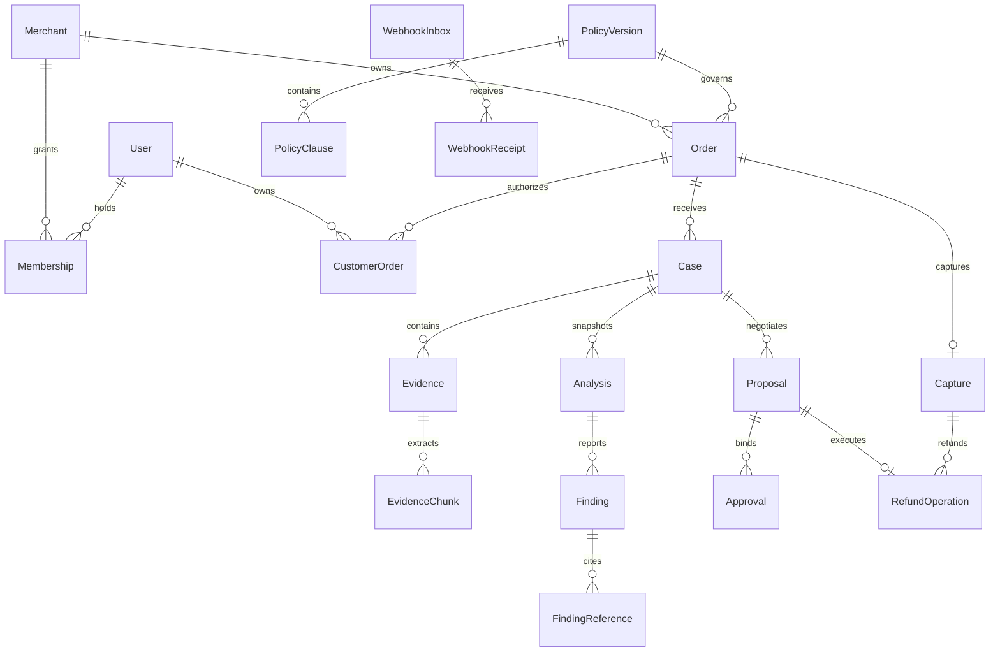

# Database design

## Conventions and isolation

PostgreSQL/Prisma with checked-in SQL migrations for RLS, partial indexes, checks and immutability triggers. UUID IDs, UTC timestamptz. Every tenant entity has merchant_id NOT NULL and UNIQUE(merchant_id,id); tenant relationships use composite FK(merchant_id,parent_id). Tenant aggregate roots have version INT for optimistic concurrency. Financial/consent/audit FK deletion is RESTRICT.

User/Session are global; Membership grants merchant roles. CustomerOrder explicitly binds user to order, never email-only ownership. Every API query checks tenant and role/ownership. Transaction-local app.merchant_id and app.user_id use parameterized set_config in short transactions. FORCE RLS on tenant tables; runtime API/worker roles lack BYPASSRLS/table-owner rights. Separate migration credentials. Dedicated scoped membership/account lookup handles tenant discovery; arbitrary cross-tenant browsing is forbidden. Worker context comes from persisted events and entity matches.

Money: BIGINT minor units with CHAR(3) uppercase currency, versioned exponent allowlist (USD=2 initially). JSON minor is decimal integer string, never JS number. Range 0..999999999999, transfers strictly positive. No floats/FX/cross-currency totals.

## Tables

All tenant tables include id, merchant_id, created_at. Mutable roots include updated_at/version. Published financial and decision content is immutable.

| Table             | Fields and constraints                                                                                                                                                                                                                                                                                                    |
| ----------------- | ------------------------------------------------------------------------------------------------------------------------------------------------------------------------------------------------------------------------------------------------------------------------------------------------------------------------- |
| Merchant          | name, status, default_currency; tenant root                                                                                                                                                                                                                                                                               |
| User              | normalized_email unique, password_hash, status                                                                                                                                                                                                                                                                            |
| Membership        | user_id, role OWNER/APPROVER/AGENT, active; UNIQUE(merchant_id,user_id)                                                                                                                                                                                                                                                   |
| Session           | user_id, token_hash unique, expires_at, last_seen_at, revoked_at; global                                                                                                                                                                                                                                                  |
| PaymentAccount    | environment, provider_merchant_id, credential_secret_ref, webhook_id, account_key; UNIQUE(environment,provider_merchant_id), unique account_key; one tenant/account                                                                                                                                                       |
| PolicyVersion     | sequence, content_hash, effective_from, published_at; UNIQUE(merchant_id,sequence); immutable once published                                                                                                                                                                                                              |
| PolicyClause      | policy_version_id, clause_key, text, rules_json; UNIQUE(merchant_id,policy_version_id,clause_key); strict rule schema                                                                                                                                                                                                     |
| Order             | customer_user_id, purchase_policy_version_id, merchant_reference, amount_minor, currency, status, version; UNIQUE(merchant_id,merchant_reference)                                                                                                                                                                         |
| CustomerOrder     | order_id, user_id; UNIQUE(merchant_id,order_id,user_id)                                                                                                                                                                                                                                                                   |
| OrderItem         | order_id, description, positive quantity, unit_minor, tax_minor, shipping_minor, currency; aggregate totals validated                                                                                                                                                                                                     |
| CheckoutOperation | order_id, account_id, kind CREATE/CAPTURE, request_id, request_hash, provider_order_id nullable, state, attempts/lease/next_attempt fields; UNIQUE(account_id,request_id), unique active kind/order                                                                                                                       |
| Capture           | order_id, account_id, provider_capture_id, provider_order_id, gross_minor, currency, provider_status, completed_at, reserved_minor, refunded_minor, external_refunded_minor, reconciliation_status, discrepancy_json, version; UNIQUE(account_id,provider_capture_id); P0 UNIQUE(merchant_id,order_id)                    |
| Case              | order_id, opened_by, policy_version_id, reason, description, status, current_proposal_id nullable, data_revision, version; partial UNIQUE(merchant_id,order_id) for active cases                                                                                                                                          |
| Evidence          | case_id, uploader_user_id, object_key unique, object_version, filename, detected_type, size_bytes, sha256, scan_status, extraction_status; validated object immutable                                                                                                                                                     |
| EvidenceChunk     | evidence_id, ordinal, page nullable, char_start/end, text_hash, sanitized_text; UNIQUE(merchant_id,evidence_id,ordinal)                                                                                                                                                                                                   |
| Analysis          | case_id, snapshot_hash/json, model_id, prompt/schema/policy_engine versions, status, review_reasons, latency_ms, token_usage; successful content immutable                                                                                                                                                                |
| Finding           | analysis_id, kind, statement, certainty_band, review_status                                                                                                                                                                                                                                                               |
| FindingReference  | finding_id, evidence_chunk_id nullable, trusted_record_type/id nullable, record_field, start/end, quote_hash; exactly one evidence/trusted-record reference; allowlisted record type, tenant checked                                                                                                                      |
| Proposal          | case_id, analysis_id nullable, policy_version_id, sequence, supersedes_id nullable, kind, amount_minor/currency nullable, terms_json, content_hash, expires_at, status, row_version; UNIQUE(merchant_id,case_id,sequence)                                                                                                 |
| Approval          | proposal_id, actor_user_id, actor_role CUSTOMER/MERCHANT, decision, content_hash, policy_version_id, decided_at, authentication_context; UNIQUE(merchant_id,proposal_id,actor_role); immutable                                                                                                                            |
| RefundOperation   | capture_id, proposal_id, account_id, amount_minor, currency, provider_request_id, request_hash, provider_refund_id nullable, state, attempts, lease_owner/until, next_attempt_at, error_code, version; UNIQUE(merchant_id,proposal_id), UNIQUE(account_id,provider_request_id), unique nonnull provider_refund_id/account |
| PaymentAttempt    | exactly one refund_operation_id/checkout_operation_id, attempt_no, request_hash, started/finished_at, transport_outcome, provider_debug_id; unique operation/attempt                                                                                                                                                      |
| ExternalRefund    | capture_id, account_id, provider_refund_id, amount_minor, currency, state; UNIQUE(account_id,provider_refund_id); imported and disjoint from local refunds                                                                                                                                                                |
| FormalDispute     | case_id nullable, account_id, provider_dispute_id, state, last_synced_at; UNIQUE(account_id,provider_dispute_id); separate lifecycle                                                                                                                                                                                      |
| WebhookInbox      | account_id, provider_event_id, verification/processing_status, attempts, received_at; UNIQUE(account_id,provider_event_id)                                                                                                                                                                                                |
| WebhookReceipt    | inbox_id, original_payload_encrypted_ref, payload_hash, redacted_headers, verification_status, received_at; multiple delivery candidates prevent invalid-first poisoning                                                                                                                                                  |
| AuditEvent        | aggregate_type/id, actor_type/id, action, visibility, correlation_id, redacted_metadata, occurred_at; append-only                                                                                                                                                                                                         |
| OutboxEvent       | aggregate_type/id, event_type, schema_version, payload_ids, dedupe_key, available_at, lease_until, delivered_at, attempts; UNIQUE(merchant_id,dedupe_key)                                                                                                                                                                 |
| IdempotencyRecord | actor_id, route_scope, key, request_hash, operation_id/result_ref, expires_at; UNIQUE(merchant_id,actor_id,route_scope,key)                                                                                                                                                                                               |

## Indexes and financial invariants

Index composite FKs. Case(merchant_id,status,created_at DESC,id), Order(merchant_id,customer_user_id,created_at DESC,id), Evidence(merchant_id,case_id,scan_status), Analysis(merchant_id,case_id,created_at DESC), AuditEvent(merchant_id,aggregate_type,aggregate_id,occurred_at,id), Membership(user_id,active). Operational indexes RefundOperation(state,next_attempt_at), undelivered OutboxEvent(available_at), WebhookInbox(processing_status,received_at). Cursor paging timestamp+id; allowlisted filters.

Per capture: completed local + completed external + active local reservations <= gross. Nonnegative counter CHECKs enforce this locally. reserved_minor includes READY/IN_FLIGHT/PENDING/UNKNOWN. Completion moves reservation to refunded_minor atomically once; definitive failure releases once. UNKNOWN never releases. External refunds may reveal an overcommit beyond local control: preserve discrepancy separately, freeze capture, alert, do not fabricate a lower provider total or drop reservations to satisfy CHECKs.

Reservation transaction locks Capture -> Case -> Proposal; rechecks consent/policy/balance, inserts unique operation, reserves money, writes audit/outbox, commits. No network calls inside transactions. Worker leases fence local writes but not late external calls; stable provider keys are still required. Retry deadlock/serialization failures with bounds. Aggregate counters have reconciliation tests and periodic verification.

Refund proposals require positive money matching capture. FULL_REFUND means the entire currently refundable remainder, frozen explicitly; changed remainder requires new version/consent. PARTIAL_REFUND is less than remainder at publication. REPLACEMENT/REQUEST_EVIDENCE/ESCALATION have NULL money. Purchase policy remains immutable; retroactive weakening is forbidden. Uncertain legal exceptions escalate to humans.

User writes compare version; immutable content triggers protect proposals/policies/approvals, while proposal status/row_version may change. Deferred FK/transaction ordering resolves Case.current_proposal_id cycles. Durable operation uniqueness outlives HTTP idempotency-cache TTL (24h); expiry cannot allow another refund for the same proposal.

## Deterministic policy contract

PolicyClause.rules_json is a strict versioned object: schemaVersion=1; applicableReasons=allowlisted reason[]; allowedRemedies=remedy[]; complaintWindowDays=integer|null; requiredEvidenceTypes=evidenceType[]; maxPartialRefundBps=integer 0..10000|null; replacementAllowed=boolean; mandatoryHumanReview=boolean. Unknown keys/operators reject publication. No executable expressions, external URLs or model-generated predicates. Currency and refundable balance are system invariants, not merchant-configurable exceptions. Partial ceiling uses integer floor(remainingMinor*bps/10000). Full-refund eligibility is separately controlled by allowedRemedies; a partial ceiling does not silently cap a full remedy.

Evaluate all applicable clauses against the purchase snapshot. For intersecting applicable rules use the strictest compatible restriction; conflicting remedy sets, missing dates/evidence or ambiguous applicability block automatic recommendation publication and require human escalation. Policy-engine returns {eligible,allowedRemedies,remainingMoney,partialCeilingMoney,blockingReasons,reviewReasons,clauseIds,engineVersion}. Human review may resolve facts or propose another policy-valid remedy; it cannot bypass financial constraints. Unrepresented legal exceptions remain escalation, not an undocumented override. Clause publication is owner-only and does not mutate historic purchase policies.

## Phase 2 schema corrections

FindingReference uses nullable evidenceChunkId/orderId/captureId/policyClauseId typed foreign keys with exactly one present. Proposal and RefundOperation carry orderId to enforce same-order relations; Case.currentProposalId has a same-case composite foreign key. CustomerOrder binds the same customer identity as Order. Completion timestamps are explicit. Prisma models are scalar-centric; SQL migrations are the source of relational constraints, not Prisma relation-navigation fields. Do not use db push or infer migration completeness from Prisma validation alone.

Membership discovery allows SELECT only for app.user_id; CustomerOrder discovery likewise returns explicit self bindings before a merchant is selected. All other tenant access requires transaction-local merchant/actor context. RLS settings are supplied by trusted server code, not browser IDs; RLS does not defend against theft of application database credentials or arbitrary SQL execution by that trusted role. The migration owner has an explicit maintenance policy; runtime cannot assume it. A fixed-search-path boolean-only SECURITY DEFINER function verifies an original approver without exposing other users' memberships. Row-lock permissions are restricted to version columns on Case/Proposal.

The internal reservation primitive validates consent, fresh approver identity, immutable version, capture association and balance. It is not an exposed refund API, does not execute provider calls, and does not enqueue an executable outbox event. Full policy-clause evaluation and payment execution remain later-phase gates.

## Phase 3 additive migrations

0005_checkout_delivery adds account enablement/worker role assignment, Order.paymentState, immutable checkout payload/actor/provider metadata, first-attempt/retry deadline, Capture.verifiedAt, receipt fingerprinting, outbox lease ownership, scoped worker grants and narrow encrypted-receipt ingestion. 0006_payment_retry adds postAttempts and prevents rejected receipts permanently consuming the event's delivery slots. 0007_customer_outbox permits customers to read only their own checkout outbox records for safe conflict handling. 0008_execution_guards adds scoped merchant-status reads and closes old/new parent line-item mutation paths.

Existing operation states stay unchanged. Buyer-facing payment state is a separate checked string contract, including reconciliation-required and cancellation. One logical CREATE/CAPTURE operation per order is enforced even after failure; no automatic replacement intent. Capture rows represent verified completed payments only; pending captures remain operations. Schema remains scalar-centric and SQL-owned for relations/RLS. No existing migration or financial reservation primitive was recreated.

Development provisioning creates resolve_payments and resolve_payments_test as non-owner, non-superuser, NOBYPASSRLS, NOINHERIT roles with no memberships. Workers cannot select User/Session/RefundOperation or mutate policies/cases. PaymentAccount.workerRoleName defines discoverable scope, and transaction-local merchant context is additionally mandatory. Separate runtime/migration/worker URLs must never be interchanged. Existing deployments must provision roles before applying new grants; resolve duplicate historical CREATE/CAPTURE rows through explicit review before the new unique index, never automatic merging.

## Phase 4 additive implementation

Migrations 0009?0012 add CaseComment, CaseTimelineEvent, PolicyDraft and EvidenceWorkerTenant, plus complaint metadata, AWAITING_CUSTOMER, INCORRECT_AMOUNT, evidence upload/scanner/lease/artifact fields and an active policy pointer. SQL guards enforce immutable case snapshots, published policy/draft content, scan evidence and timeline history. Customer visibility policies exclude internal notes at the database layer. Existing one-active-case/order uniqueness is retained; API order locks additionally enforce three lifetime cases and a 24h reopening-as-new cooldown. The purchase policy is never replaced on an existing order/case. See PHASE-4-REPORT.md.

## Phase 5 additive schema (SQL authoritative)

0013_ai_intelligence adds AISharingPolicy, AIContext, AIConsent, AIRevocation, EvidenceExtraction, AnalysisSource, AIRecommendation, AIReview, AIUsage, AIBudget and AIWorkerTenant; extends existing Analysis, EvidenceChunk and FindingReference. All new tenant tables have ENABLE/FORCE RLS, composite tenant FKs and explicit grants. Customers can read/consent only their own previews; Analysis/findings/recommendations/reviews are merchant-only. Sources have exactly one typed reference and same-case guards. Published sharing policy, consent, revocation, source catalog, recommendation and review are immutable.

0014_ai_guards adds usage dispatch timestamps, immutable output hashes, extraction-aware chunk uniqueness and expiry cleanup. 0015_ai_delivery grants only assigned ai.prepare/ai.analyze outbox rows to their workers. 0016_ai_privacy_recovery replaces plaintext comment manifest bodies with hashes and corrects two-stage immutable-output expiry. 0017_ai_retention permits only age-gated encrypted derivative erasure after 30 days, retaining metadata/hashes.

Analysis has fenced leases, versions, bounded attempts, encrypted validated result, exact model/prompt/schema versions and unique active snapshot/case/tenant indexes. AIContext binds encrypted base/request/catalog, manifest, policy, selected IDs, expiry and consent hash. AIUsage reserves integer micro-USD before external calls; unknown outcomes retain budget. Runtime roles own no schema and cannot bypass RLS. These migrations do not modify completed captures, financial counters or existing policy/case content.

0018_ai_extraction_outcomes persists immutable failed/successful extraction outcomes separately and checks consent/review actor identity and approver role in RLS.

0019_ai_authoritative_inputs restricts preparation UPDATE grants to derivative/lease fields and makes source manifests/base inputs immutable before readiness too. Inference and review independently recompute trusted financial candidates.

## Gemini additive migrations

0020_gemini_provider adds AISharingPolicy.providerId (default openai) with explicit provider/model pairing, plus Case.aiSyntheticAuthorized (default false). Existing tenant RLS/immutability remains. Only session_user=resolve_migrator may authorize synthetic fixtures; no application endpoint/grant bypass is provided.

0021_gemini_fixture_freshness adds the authorized Case version and checks Google context freshness against it under the existing scoped function/lock order. Source changes invalidate classification and consent freshness. OpenAI manifests/policies/consents remain intact. These migrations do not touch capture/refund/financial counters.

0022_gemini_selected_model extends the existing AISharingPolicy provider/model CHECK to permit the explicitly reviewed gemini-3.5-flash-lite while retaining legacy2.5 and OpenAI. It rewrites no policy/consent/financial record and changes no RLS permissions.

## Phase 6 milestone A negotiation

Additive migrations 0023/0024 extend existing Proposal with immutable createdBy/authorRole/contextHash/policyChecks, WITHDRAWN lifecycle and append-only FORCE-RLS ProposalPublication. Published receipts enforce customer visibility without exposing private draft history. Same-case supersession FK already exists and is reused. Single OFFERED row per case is enforced by a partial index; source hashes, case locks, version checks and idempotency supplement RLS. No financial table or existing migration is rewritten. See PHASE-6-A-REPORT.md for role permissions and legacy compatibility.

## Phase 6 settlement additions

0025 adds FORCE-RLS Settlement exact-consent/authorization records, immutable refund payload/dispatch markers, account refundMode=disabled by default, approval uniqueness and assigned-worker access. 0026 narrows worker Case/Proposal reads; 0027 grants only Case.version SELECT required by version=version+1. Private case descriptions and proposal terms remain unreadable to payment workers. Existing migrations and financial data are preserved. Settlement/approval identity is immutable; execution state updates and counters commit atomically under Capture -> Case -> Proposal locks. See PHASE-6-REPORT.md.

0027_refund_case_version restores only SELECT(Case.version), which is required by the atomic UPDATE version=version+1; private worker-field restrictions remain. 0028_settlement_completion adds the narrow runtime completion timestamp grant and database settlement/consent guards. No capture or financial counter is rewritten by these migrations.

## Phase 7 additive changes

0029 adds forced-RLS DemoTenant and immutable AISharingPolicy.executionMode (existing policies default external). Only migration credentials mark demo tenants; runtime and restricted workers have scoped SELECT, never INSERT/UPDATE/DELETE grants. Mock policies require that marker and bind a distinct local disclosure. 0030 adds the fixed-search-path boolean mock_context_allowed guard, restricted to the transaction tenant, assigned role/authorized actor and verified SYNTHETIC_ capture, plus merchant/period analytics indexes. No payment or historical migration is replaced. Analytics use a read-only REPEATABLE READ transaction with explicit tenant filters and existing RLS.
